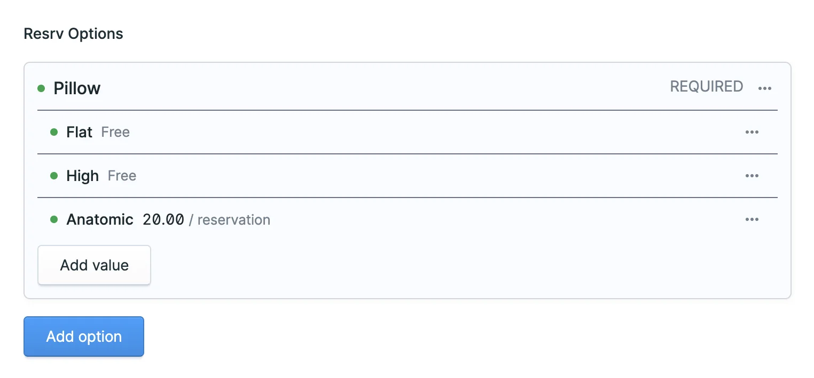

Options are a great way to add a bit of flexibility to your Reservations. They allow you to add a number of values to a specific Option and let the user choose between them.

They are similar to Extras, but they are less advanced and bound to each Entry by default. You can read the diferences between Extras and Options in the [Extras](/extras#extras-or-options) docs.

## Managing Options

To manage your Options, you need to add the `Resrv Options` field to your Blueprint. Then in your entry you can add as many options as you want.

<Frame caption="The Resrv Options field in your Entry.">
  
</Frame>

Each option can be `Required` or `Optional`. If an option is required, the user will have to select a value during checkout.

Each option value's price can be set to be Free, Per day or Fixed. Per day and Fixed prices are multiplied by the reservation quantity, unless **Ignore quantity for prices** is enabled in your [configuration](/configuration). A rate can change what counts as one unit with **[Booked units per add-on](/rates#booked-units-per-add-on)**.

## Where options apply

Like [Rates](/rates), options are **collection-scoped**. An option you create in an entry's Options field belongs to that entry's collection and applies to that entry by default. It stores its `collection` and the entries it's attached to, so you can reuse one option across several entries.

:::tip
For now, you can only assign an option to multiple entries (or a whole collection) through the backend API. A Control Panel screen for this is coming in a later release.
:::

## Disabling a value for an entry

You can turn off a value for a single entry, for example a "Child seat" value that one vehicle can't offer. In the entry's Options editor, open the menu next to the value and choose **Disable for this entry**. The value is hidden and can't be selected at checkout, but only for that entry. Choose **Enable for this entry** to bring it back.

If you disable every value of a required option for an entry, the option is skipped for that entry.

## Price snapshots

A reservation keeps a copy of the chosen option's name, price and price type. Changing, disabling or deleting an option or value later doesn't change what past reservations charged or what their confirmation emails show.