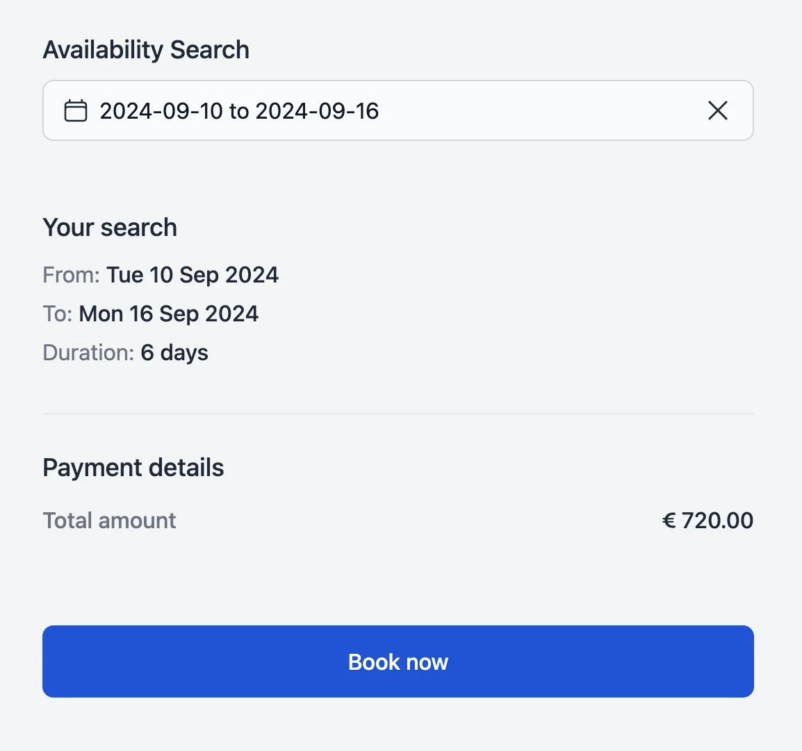

The `availability-search` component is the search form visitors use to pick their dates, and optionally a [rate](/rates) and a quantity. You pair it with a component that shows what's available.

## Which component to use

| You want | Use |
| --- | --- |
| Availability of **one** entry on its page | [`availability-results`](/availability-results) |
| **Upcoming available dates** for one entry | [`availability-list`](/availability-list) |
| A **cart** of several rates or dates for one entry | [`availability-multi-results`](/cart-booking) |
| **Many entries** of a collection, live, no extra package | [`availability-collection`](/availability-search-multiple#the-availability-collection-component) |
| Many entries, with availability as one **filter** among others | [`lf-availability-filter`](/availability-search-multiple#livewire-filters-filtering-beyond-dates) (requires `reachweb/statamic-livewire-filters`) |
| Many entries, server-rendered with a page reload | [the `resrv_search` collection-tag query scope](/availability-search-multiple#collection-tag-server-rendered) |

## Adding the search

```antlers
{{ livewire:availability-search calendar="range" }}
```

Resrv saves each search in the visitor's session, so it carries over to other pages. A saved rate that doesn't apply to the current entry is dropped, and when there's only one rate, it's selected for the visitor.

<Frame caption="The availability search, with availability-results below it.">
  
</Frame>

## Properties

| Property | Default | Description |
| --- | --- | --- |
| `calendar` | `single` | `single` picks one date, `range` picks a date range. |
| `live` | `true` | Updates the results as the visitor changes their search. Set it to `false` to search only when they press **Search**. |
| `redirectTo` | | With `live` off, the URL to send visitors to when they press **Search**. Without it, the page reloads. |
| `rates` | `false` | Shows the [rate](/rates) selector. Pass `:rates="true"`. |
| `anyRate` | `false` | For [multiple entries](/availability-search-multiple): with no rate selected, searches every rate and shows the cheapest. It also allows searching without dates. Pass `:any-rate="true"`. |
| `enableQuantity` | `false` | Adds a quantity picker, so visitors can book more than one at once. |
| `overrideRates` | `[]` | Your own `rate_id => label` map for the rate selector. |
| `showAvailabilityOnCalendar` | `false` | Shows availability and prices on the calendar. Only for a [single entry](/availability-search-single#display-availability-in-the-calendar), and needs `entry`. |
| `entry` | | An entry ID, to load that entry's rates. |
| `ratesBlueprint` | | A `collection.blueprint`, mainly for Livewire Filters. |
| `view` | `availability-search` | A custom view in `resources/views/vendor/statamic-resrv/livewire`, for example a different search form on your home page. |

## A search form on another page

To put a search form on your home page that sends visitors to a results page, turn off `live` and set `redirectTo`:

```antlers
{{ livewire:availability-search calendar="range" live="false" redirectTo="/rooms" }}
```

The results page picks up the search from the session. For the results themselves, see [single entry](/availability-search-single) or [multiple entries](/availability-search-multiple).

## Setting the search via URL parameters

You can fill in the search from a link, for example in a newsletter. This opens the page with the dates set and the results loaded:

```text
https://yoursite.com/villa-blue?date_start=2026-08-20&date_end=2026-08-25&rate=3
```

| Parameter | Example | Description |
| --- | --- | --- |
| `date` | `?date=2026-08-20` | The start date. The end date follows your minimum reservation period. |
| `date_start` and `date_end` | `?date_start=2026-08-20&date_end=2026-08-25` | An exact date range. |
| `rate` | `?rate=3` | A [rate](/rates) by its ID, or `any` when `anyRate` is on. |

Dates use the `YYYY-MM-DD` format. The link replaces any search saved in the session, and invalid values, like a past date, are ignored. On a form with `live` off, the link fills in the form but the visitor still presses **Search**.

## Passing data to checkout

You can send values from the search to the checkout form, like the number of guests from the [Guests component](/guests). Bind your control to `data.customer.<handle>`, and add a field with the same handle to your [checkout form](/checkout#checkout-form). To stop visitors changing it at checkout, make that field hidden.

## Customizing

The search form is plain by default, so you can match it to your site. Publish the views:

```bash
php artisan vendor:publish --tag=resrv-checkout-views
```

Then edit `resources/views/vendor/statamic-resrv/livewire/availability-search.blade.php`. The parts it uses are in the `components` folder next to it, like the rate selector in `availability-rates.blade.php`.

### Disabling days of the week

To stop visitors picking certain days, add `disabledDays` to the dates component in your published `availability-search.blade.php`, with full English day names:

```blade {3}
<x-resrv::availability-dates
    :$calendar
    disabledDays='["Saturday", "Sunday"]'
    :errors="$errors"
/>
```
