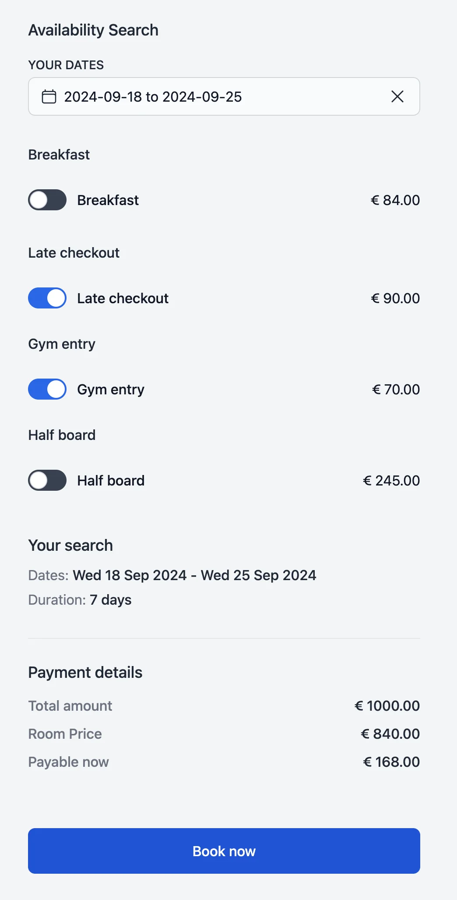

The `availability-results` component shows whether one entry is available for the visitor's search, with its price and a **Book now** button that starts the checkout. Not sure this is the right component? See [which component to use](/availability-search-component#which-component-to-use).

## Adding the results

Put it on the entry's page, with an [`availability-search`](/availability-search-component) so visitors can change their dates:

```antlers
{{ livewire:availability-search enableQuantity="true" calendar="range" }}
{{ livewire:availability-results :entry="id" }}
```

When the visitor presses **Book now**, Resrv creates a pending reservation and takes them to the [checkout](/checkout). See [single entry](/availability-search-single) for more examples.

## Properties

| Property | Default | Description |
| --- | --- | --- |
| `entry` | | The entry's ID. Required. |
| `rates` | `false` | Shows [rate](/rates) labels. |
| `rateSorting` | `order` | The order of the rates: `order` (as set in Rates) or `price` (cheapest first). |
| `overrideRates` | `[]` | Your own `rate_id => label` map for the rate labels. |
| `showExtras` | `false` | Shows the entry's [extras](/extras): `true` for all, or an array of extra IDs. |
| `showOptions` | `false` | Shows the entry's [options](/options): `true` for all, or an array of option IDs. |
| `extraDays` | `0` | Also checks the same stay moved up to this many days earlier and later, to suggest nearby dates. |
| `extraDaysOffset` | `0` | Spaces those dates out. With `1`, they move by 2, 4, 6 days instead of 1, 2, 3. |
| `view` | `availability-results` | A custom view in `resources/views/vendor/statamic-resrv/livewire`. |

## Working with rates

If the entry has more than one [rate](/rates), turn on `rates` in both components. When the visitor searches any rate, each available rate gets its own row, price and **Book now** button:

```antlers
{{ livewire:availability-search :rates="true" :any-rate="true" }}
{{ livewire:availability-results :entry="id" :rates="true" rateSorting="price" }}
```

Rates with a cancellation policy show a label:

- **Non-refundable** for non-refundable rates.
- **Free cancellation until \<date\>** for rates with a free cancellation period.
- **No free cancellation for these dates** when that date has already passed for this check-in.

See [Rates](/rates) to set the policies.

## Extras and options

Extras and options are normally chosen at [checkout](/checkout). To let visitors pick them next to the results instead, turn on `showExtras` or `showOptions`:

```antlers
{{ livewire:availability-results :entry="id" showExtras="true" }}
```

<Frame caption="Availability results with the extras shown.">
  
</Frame>

## Customizing

Publish the views with `php artisan vendor:publish --tag=resrv-checkout-views`, then edit `resources/views/vendor/statamic-resrv/livewire/availability-results.blade.php`. The rate rows are in `components/availability-results-advanced.blade.php`.

## Related

- [Availability List](/availability-list): upcoming available dates for one entry.
- [Availability Collection](/availability-search-multiple#the-availability-collection-component): availability for many entries at once.
- [Cart booking](/cart-booking): several rates and dates in one reservation.
