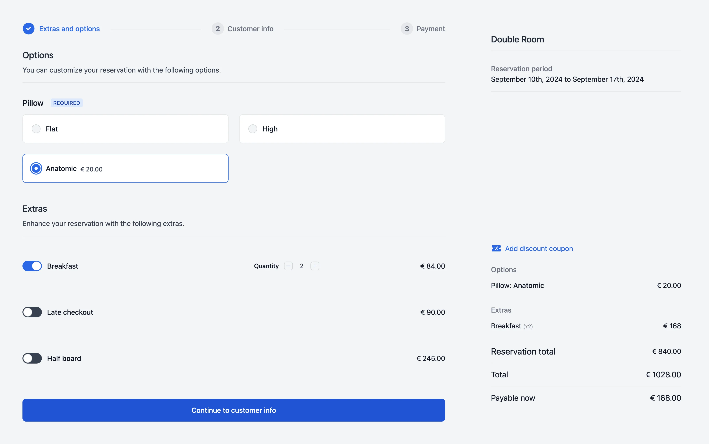
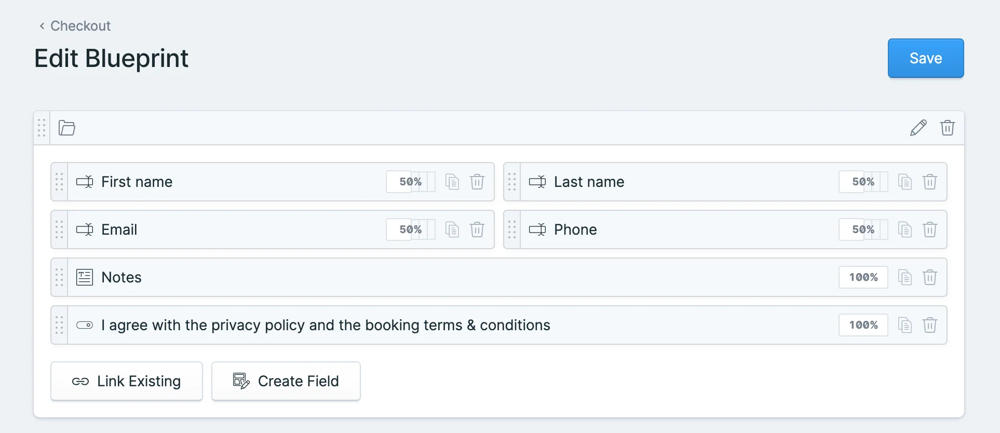
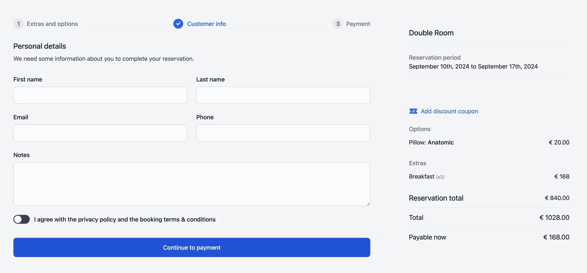

The `Checkout` component handles the whole checkout process: it allows the user to select extras or options, lets them add a coupon for a discount, gets the user's personal details, and handles the payment.

In v6 the checkout supports **multiple payment gateways**.

In this page, we'll go over the setup required for the `Checkout` component to function correctly and how to customize it to fit your needs.

## Component basics

Before using this component, let's go through the required steps to get it working:

1. You need to create an Entry that will be used as the checkout page. This Entry can follow your website's design but must have a different template that will include the `Checkout` component.
2. You also need to create a "Checkout complete" page. Again, this page can be like any page on your site, but in its template, you must include the `resrv_checkout_redirect` tag.
3. You need to create the checkout form. If you used the installer, a sample checkout form is already published for you to edit.
4. You must configure and enable at least one payment gateway to accept payments. See [Payment gateways](/payment-gateways), [Stripe](/stripe) and [Mollie](/mollie).

## Checkout Component

To load the Checkout component, first create a new Entry in your default collection (for example "Pages"). Create a custom template for this page and include the `Checkout` component:

```antlers
{{ livewire:checkout }}
```

As simple as that! The component has a few properties that you can set to customize it to your needs:

| Property | Type | Default | Description |
| -------- | ---- | ------- | ----------- |
| enableExtrasStep | boolean | true | By default the component starts with a step that allows the user to select Extras / Options. If you don't use them, you can disable it by setting this to false. |
| enableCoupon | boolean | true | By default the component allows the user to add a discount coupon, you can disable this here if you don't use them. From v6 it's set once on mount and can't be changed client-side. |
| view | string | "checkout" | You can override the view that is used to render the component. Expects a `name.blade.php` file in the `/resources/views/vendor/statamic-resrv/livewire` folder. |

Set them as snake_case attributes on the tag:

```antlers
{{ livewire:checkout enable_extras_step="false" enable_coupon="false" view="my-checkout" }}
```

<Frame caption="The checkout component.">
  
</Frame>

## Checkout steps

The checkout has three steps:

1. **Extras & options**: The user picks any [Extras](/extras) and [Options](/options). Skipped when `enableExtrasStep` is `false` (extras or options already in the session still apply).
2. **Personal details**: The user fills in the checkout form. The button reads *"Continue to payment"*, or *"Confirm reservation"* when nothing is due.
3. **Payment**: With more than one gateway, the user picks one first (see below). With a single gateway, it's selected automatically. With a zero price, this step is skipped and the reservation is confirmed (see [Skip Payment](#skip-payment)).

The step indicator hides any skipped steps.

## Selecting a payment method

When more than one gateway is available for the reservation total, the user picks one under **Select payment method**. Each option shows the gateway label and any surcharge, for example `(+10% surcharge)` or `(+€ 5 surcharge)`.

Once they choose, the surcharge is added and the gateway's payment form is shown. Redirect gateways such as Mollie send the user to the gateway and back.

{/* Screenshot not captured yet (public/img/resrv-checkout-gateway-picker.webp is missing): <Frame caption="The checkout payment method picker with multiple gateways."> */}

If the amount limits leave no gateway for the reservation total, the user stays on the details step and sees an error. Make sure your amount limits cover every total you expect.

See [Payment gateways](/payment-gateways) to set up gateways, surcharges and amount limits.

## Offline / pay-later [#offline-pay-later]

Resrv ships with an **Offline** gateway (`OfflinePaymentGateway`) for payments you collect yourself, such as bank transfers. Enable it like any other gateway (see [Payment gateways](/payment-gateways)).

The user sees the amount due and a **Confirm reservation** button instead of a card form. If there are other gateways, *Change payment method* takes them back to the picker.

Confirming books the reservation and sends the confirmation email, but takes no payment. The checkout complete page shows the `pending` status, telling the customer that payment is still to be settled. You collect the payment outside Resrv.

## Checkout Complete

After the checkout is complete, the user is redirected to the "Checkout complete" page. This page can be like any page of your site, but in its template you must include the `resrv_checkout_redirect` tag:

```antlers
{{ resrv_checkout_redirect }}
    <div class="w-full">
        <div class="text-xl xl:text-2xl font-bold mb-3 lg:mb-4">
            {{ title }}
        </div>
        <p class="lg:text-lg">
            {{ message }}
        </p>
    </div>
{{ /resrv_checkout_redirect }}
```

The tag asks the reservation's gateway how the payment went (redirect gateways pass it back in the `resrv_gateway` query parameter). It exposes these variables:

| Variable | Description |
| -------- | ----------- |
| `status` | One of `success`, `failed`, or `pending`. |
| `title` | A localized title for the result. |
| `message` | A localized message for the result. |
| `reservation` | The reservation data array. |

The three statuses are:

- **`success`** (*"Payment successful."*): the payment went through and the reservation is confirmed.
- **`failed`** (*"Payment failed."*): the customer is asked to retry or get in touch.
- **`pending`** (*"Reservation received."*): the reservation was received and payment is still to be settled. Offline and other held bookings return this.

Inside the tag you can access the `reservation` variable that contains the reservation data. This is the correct place to add any goal-based events, like Analytics.

## Choosing the checkout form

Different collections or entries can use different checkout forms. Resrv uses the first match in this order:

1. **Entry mapping**: a form mapped to the entry.
2. **Legacy `resrv_override_form`**: the v5 per-entry field, kept for backwards compatibility.
3. **Collection mapping**: a form mapped to the entry's collection.
4. **Default form**: the global default checkout form.

Set the default form and the mappings in **Resrv → Settings → Checkout** (`checkout_forms_default`, `checkout_forms_collections`, `checkout_forms_entries`).

See the [Configuration](/configuration) page for the full list of settings.

## Checkout form

We are leveraging the [Statamic form builder](https://statamic.dev/forms) in order to allow you to customize the checkout form. If you published it during the installation process, you will find it in your Blueprints.

:::warning[ALWAYS KEEP THE EMAIL FIELD]
The email field (with the handle `email`) is required for the checkout emails to work. Always make sure to keep it in your checkout form.
:::

You can use Statamic's validation tab to add validation to your fields. The fields that are implemented in the frontend are:

- Text
- Radio
- Checkboxes
- Select
- Textarea
- Integer
- Toggle
- Dictionaries <Badge variant="accent">NEW</Badge>

The dictionary *Countries* will display an AlpineJS filtered select box. Resrv adds the dictionary *Country Phone Codes* which displays a select box with all country codes plus an input box for the actual phone number.

<Frame caption="The checkout form in the Statamic form builder.">
  
</Frame>

<Frame caption="And the same checkout form in the frontend.">
  
</Frame>

## Cancellation policy

When a [rate](/rates) has a cancellation policy, the checkout sidebar shows it, for example *"Free cancellation until Mon 03 Jun 2026"*. The reservation keeps the policy it was booked with, even if you change the rate later.

Within the free-cancellation window, customers can cancel from the [Reservation Status](/reservation-status) page and are refunded automatically through the original gateway.

**Non-refundable bookings are always charged in full** at checkout, whatever your global free-cancellation settings.

## Required Configuration

For the checkout to work correctly, you need to select the Checkout Entry, the Checkout Complete Entry, and the default Checkout form in the addon's [configuration](/configuration) page.

Finally, you must also set up and enable at least one [payment gateway](/payment-gateways).

## Skip Payment

If the price of the reservation is zero, or if dynamic pricing makes it zero, the checkout is completed without any payment. This means you can use only the reservation part of Resrv. For example, if you have a restaurant that takes reservations but doesn't charge for them, you can simply set the price to zero.
